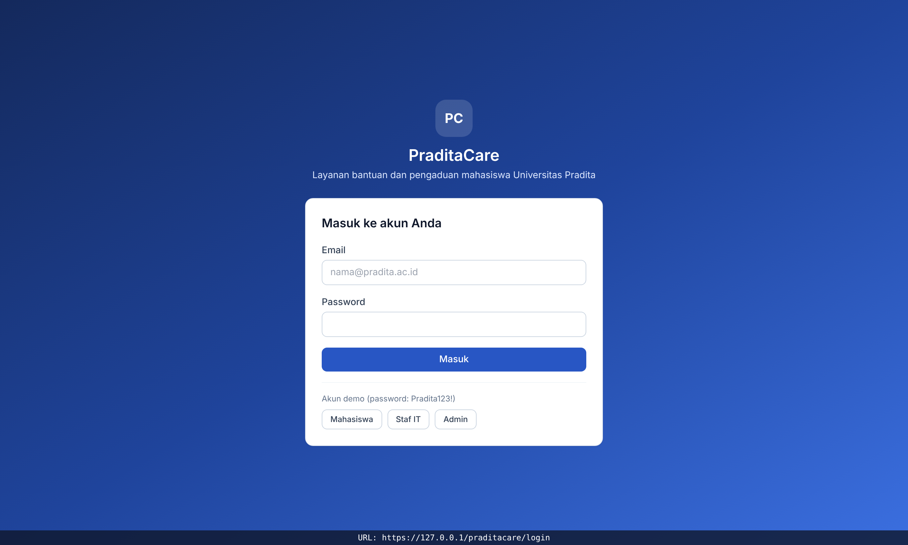
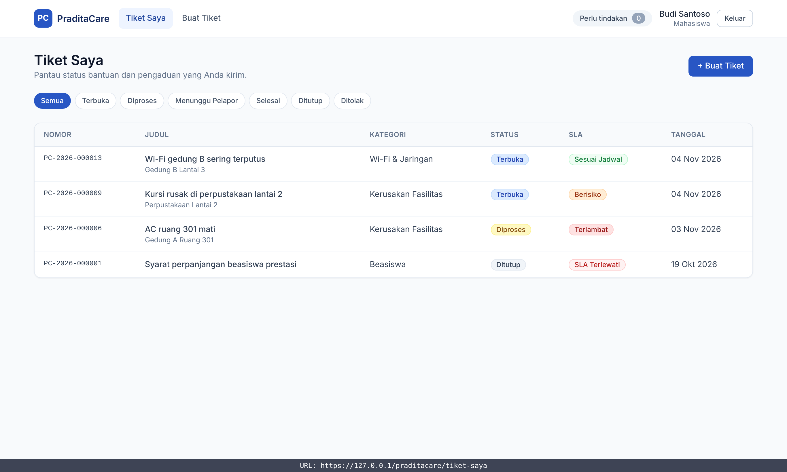
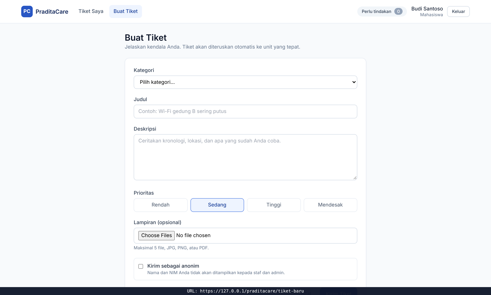
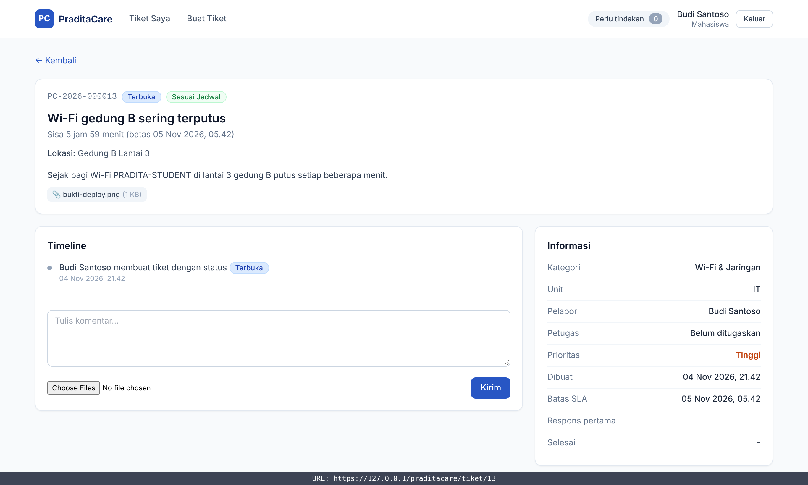
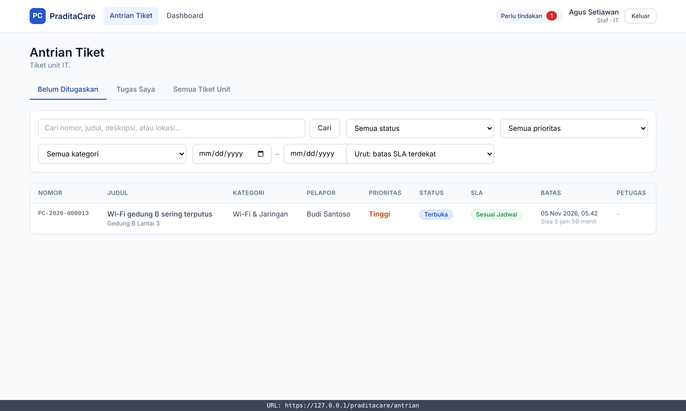
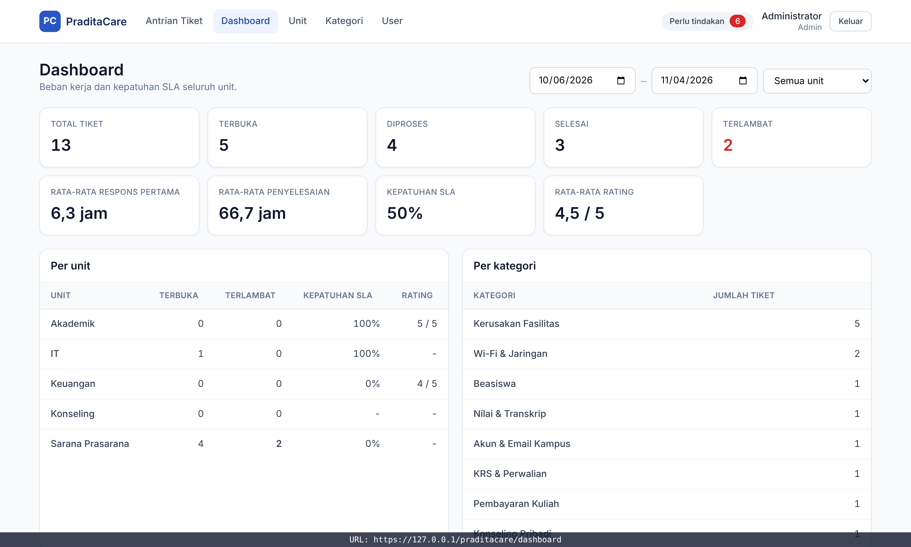
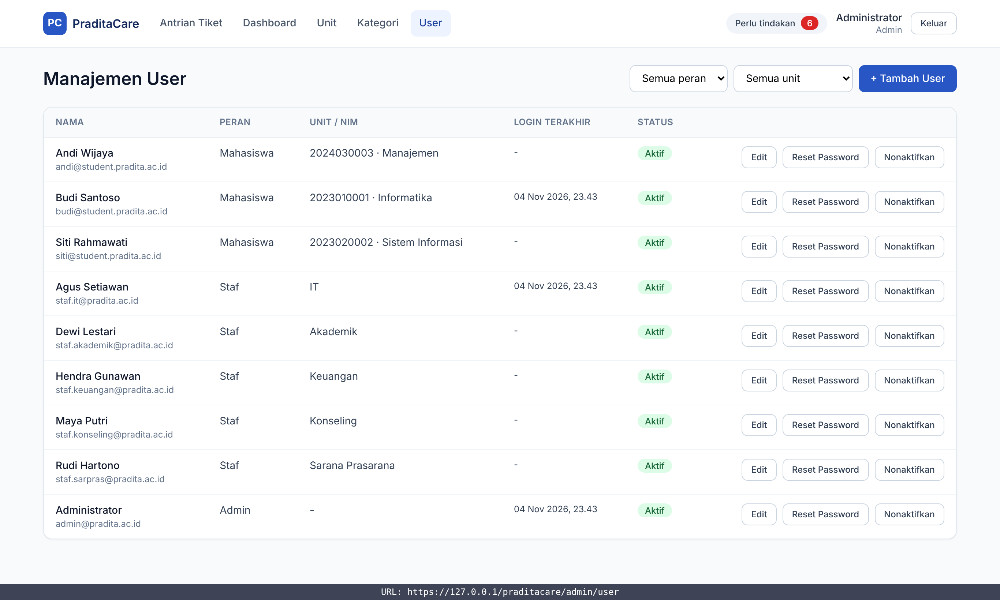
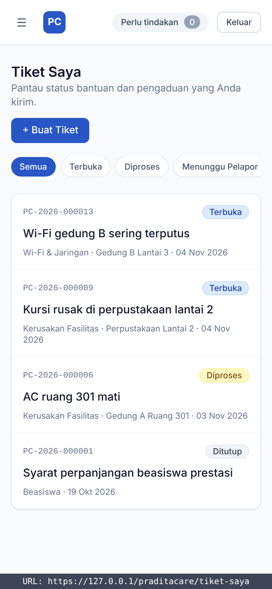

# Deployment PraditaCare: ringkasan dan bukti

Target: reviewer membuka aplikasi yang sudah online di **`https://<ip>/praditacare/`**, di VPS atau Raspberry Pi / Orange Pi.

| Dokumen | Isi |
| --- | --- |
| [DEPLOY-VPS.md](DEPLOY-VPS.md) | Fresh clone sampai online di VPS: cara A Docker, cara B tanpa Docker (systemd), HTTPS, verifikasi |
| [DEPLOY-RASPBERRY-PI.md](DEPLOY-RASPBERRY-PI.md) | Hal khusus ARM: OS 64-bit, swap, port forwarding/CGNAT, masalah umum |

## Tautan percobaan

| Lingkungan | URL | Status |
| --- | --- | --- |
| Uji lokal (sandbox, Docker + Nginx HTTPS) | `https://127.0.0.1/praditacare/` | Lulus semua cek (lihat bukti di bawah) |
| Server publik (VPS / Raspberry Pi) | `https://<IP-server>/praditacare/` | Diisi setelah deploy ke server milik tim |

Akun demo (bila `SEED_DEMO_DATA=true`), password semua `Pradita123!`: `budi@student.pradita.ac.id` (mahasiswa), `staf.it@pradita.ac.id` (staf IT), `admin@pradita.ac.id` (admin). Halaman login juga punya tombol akun demo.

## Isi paket deployment

| File | Fungsi |
| --- | --- |
| [`Dockerfile`](../../Dockerfile), [`.dockerignore`](../../.dockerignore) | Image produksi Node 22 (amd64 dan arm64), build web untuk sub-path `/praditacare/` |
| [`deploy/docker-compose.prod.yml`](../../deploy/docker-compose.prod.yml) | Stack MariaDB + app + Nginx, healthcheck, volume data dan upload |
| [`deploy/docker/entrypoint.sh`](../../deploy/docker/entrypoint.sh) | Saat container menyala: tunggu DB, `prisma migrate deploy`, seed demo opsional, nyalakan server |
| [`deploy/.env.production.example`](../../deploy/.env.production.example) | Contoh konfigurasi Docker (IP, secret, password DB) |
| [`deploy/nginx/praditacare-docker.conf`](../../deploy/nginx/praditacare-docker.conf) | Nginx di Docker: HTTP→HTTPS, `/` → `/praditacare/`, proxy `/praditacare/` ke app |
| [`deploy/nginx/praditacare-host.conf`](../../deploy/nginx/praditacare-host.conf) | Nginx di host untuk cara tanpa Docker |
| [`deploy/systemd/praditacare.service`](../../deploy/systemd/praditacare.service), [`deploy/.env.systemd.example`](../../deploy/.env.systemd.example) | Service systemd + contoh `.env` produksi |
| [`deploy/scripts/buat-sertifikat.sh`](../../deploy/scripts/buat-sertifikat.sh) | Sertifikat HTTPS self-signed untuk IP/domain |
| [`deploy/scripts/cek-online.sh`](../../deploy/scripts/cek-online.sh) | Smoke test 13 cek lewat HTTPS + sub-path |
| [`cek-browser-subpath.cjs`](cek-browser-subpath.cjs) | Cek browser (Playwright) 10 cek + screenshot otomatis |

## Cara kerja sub-path `/praditacare`

1. Nginx menerima `https://<ip>/praditacare/...`, membuang awalan `/praditacare`, lalu meneruskan ke aplikasi di port 4000. API dan server tidak perlu tahu sub-path.
2. Web dibuild dengan `VITE_BASE_PATH=/praditacare/`, sehingga:
   - aset dimuat dari `/praditacare/assets/...` (Vite `base`),
   - routing React memakai `basename="/praditacare"` (`apps/web/src/main.tsx`),
   - panggilan API memakai `/praditacare/api/...` (`ApiBase` di `apps/web/src/api/Client.ts`).
3. Tanpa `VITE_BASE_PATH` (development, `npm run dev`) semuanya tetap di root `/` seperti sebelumnya.

Normalisasi sub-path ada di `packages/shared/src/utils/BasePath.ts` dan diuji oleh `BasePath.test.ts`.

## Bukti test, build, dan deploy

Semua dijalankan pada 2026-11-04 di sandbox Linux x86_64 (Node 22, Docker 29, Nginx 1.24/1.27, MariaDB 10.11/11.4).

| No | Bukti | Hasil |
| --- | --- | --- |
| 1 | [01-unit-test.txt](bukti/01-unit-test.txt) | **123 unit test PASSED** (16 file, termasuk 4 test baru `BasePath`) |
| 2 | [02-typecheck-build.txt](bukti/02-typecheck-build.txt) | Typecheck lulus; build produksi sukses; `index.html` memuat aset dari `/praditacare/assets/` |
| 3 | [03-docker-build-dan-up.txt](bukti/03-docker-build-dan-up.txt) | Image Docker terbangun; stack db + app + nginx menyala, app *healthy*; migrasi dan seed otomatis |
| 4 | [04-cek-online.txt](bukti/04-cek-online.txt) | Smoke test Docker **13 PASS, 0 FAIL** |
| 5 | [05-cek-browser-subpath.txt](bukti/05-cek-browser-subpath.txt) | Cek browser **10 PASS, 0 FAIL**: login 3 peran, navigasi, upload lampiran, deep link, logout, tanpa error konsol, semua request tetap di sub-path |
| 6 | [06-uji-security-lewat-nginx.txt](bukti/06-uji-security-lewat-nginx.txt) | Uji security PR #5 dijalankan lewat Nginx HTTPS: **39 PASS, 0 FAIL** |
| 7 | [07-jalur-tanpa-docker.txt](bukti/07-jalur-tanpa-docker.txt) | Cara tanpa Docker (Nginx host + Node + MariaDB): `nginx -t` lulus, unit systemd valid, smoke test 13/13, browser 10/10 |

Catatan jujur tentang uji sandbox: sandbox tidak bisa mengakses mirror Debian dan terkena batas unduh Docker Hub, sehingga base image `node:22-bookworm-slim` diganti stand-in `node:22-bookworm` (sudah berisi OpenSSL). `Dockerfile` di repo tidak diubah. Sandbox juga tidak memakai systemd sebagai PID 1, jadi perintah `ExecStart` dijalankan manual dengan `.env` yang sama. Deploy ke server publik belum dilakukan karena menunggu server milik tim.

## Screenshot (lewat `https://127.0.0.1/praditacare/`)

Label URL di bawah setiap gambar adalah anotasi dari skrip screenshot, bukan bagian aplikasi.

| | |
| --- | --- |
|  Login |  Mahasiswa: Tiket Saya |
|  Mahasiswa: Buat Tiket |  Detail tiket + lampiran hasil upload |
|  Staf IT: Antrian |  Admin: Dashboard |
|  Admin: Kelola User |  Tampilan ponsel |
